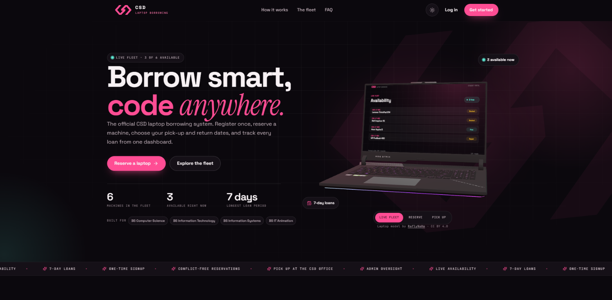

  <h1>CSD Laptop Borrowing System</h1>
  
<strong>Borrow smart. Code anywhere.</strong> 
  A simple way for the Computer Studies Department to manage shared laptops, reservations, and returns.

  

  

    <a href="#overview">Overview</a> ·
    <a href="#features">Features</a> ·
    <a href="#api">API</a>
  

  

    
    
    
    
    
  

## Overview

The CSD Laptop Borrowing System brings laptop availability, student loan requests, and inventory management into one application. Students can reserve and track equipment, while administrators manage the fleet and loan lifecycle.

## Features

| Students | Administrators |
| --- | --- |
| Browse laptop availability and details | Add, edit, and remove laptop records |
| Register and sign in | Update maintenance status |
| Request or cancel a loan | Review loans and record returns |
| Review personal reservations | Manage student account status |

Authenticated actions use JWTs, with role-based access for administrative workflows.

## Technology

| Frontend | Backend | Data |
| --- | --- | --- |
| React, Vite | Node.js, Express | MongoDB, Mongoose |

## API

| Area | Endpoints |
| --- | --- |
| Health | `GET /api/health` |
| Authentication | `POST /api/auth/register`, `POST /api/auth/login`, `GET /api/auth/me` |
| Laptops | `GET /api/laptops`, `GET /api/laptops/:id`; administrator create, update, delete, and maintenance actions |
| Loans | `GET /api/loans`, `POST /api/loans`, `PATCH /api/loans/:id/cancel` |
| Administration | Loan and student management under `/api/admin` |

Protected endpoints require a valid bearer token. Administrative endpoints are restricted to administrator accounts.
